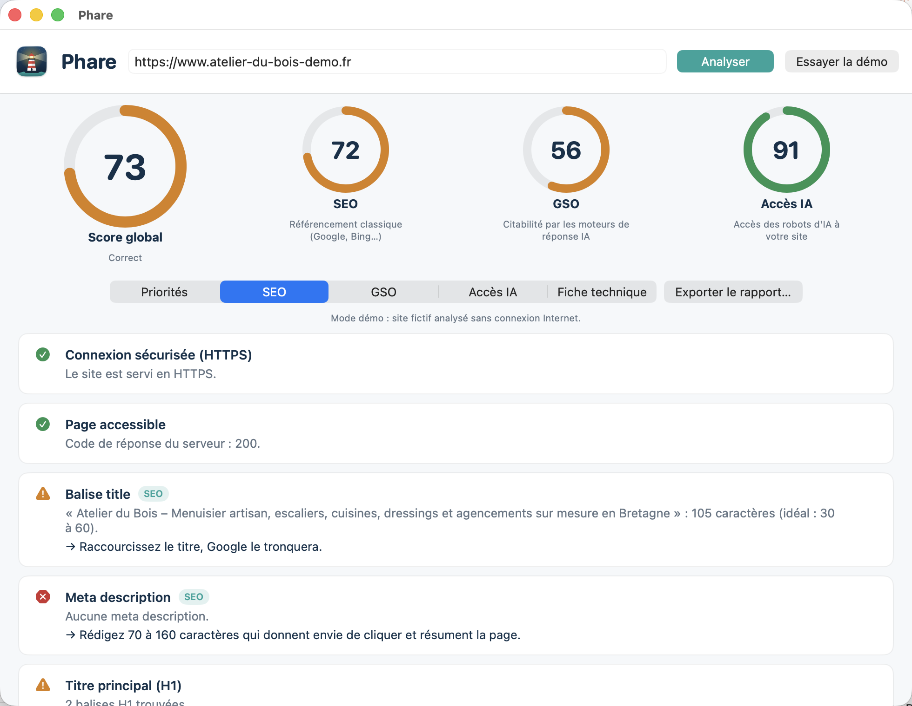
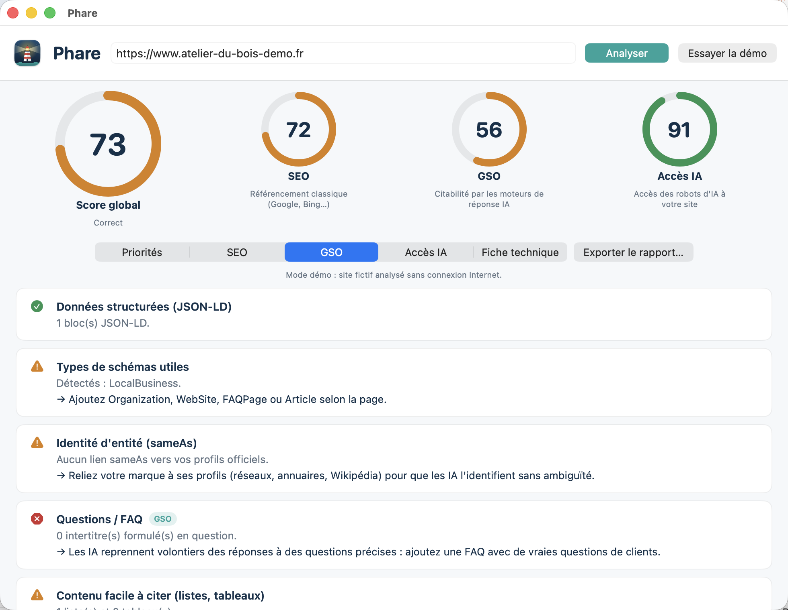
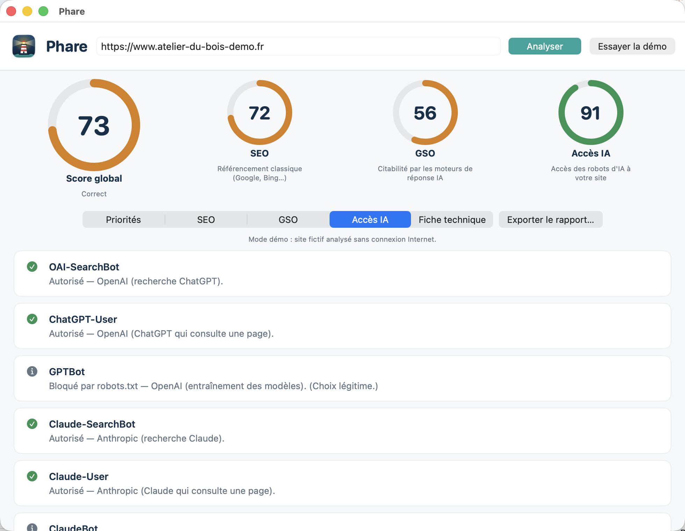
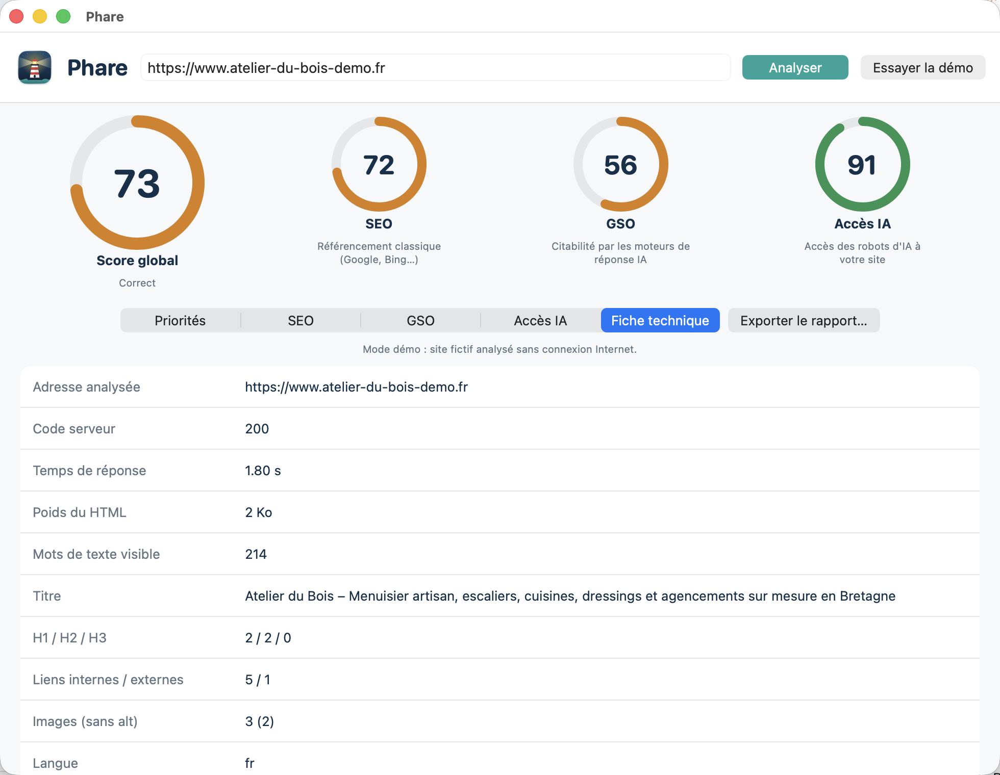

<div align="center">


# Phare

**Shine a light on your website, for Google and for AI.**

  

[Version française](README.md)


</div>

Phare is a free Mac app that audits a website on three axes:

- **SEO**: classic search optimisation (Google, Bing): title, description, headings, mobile, speed, sitemap…
- **GSO** (*Generative Search Optimization*): how easy is the site to cite for ChatGPT, Claude, Perplexity, Gemini…? Structured data, FAQ, author, dates, figures, `llms.txt`…
- **AI access**: can AI crawlers (OAI-SearchBot, ClaudeBot, PerplexityBot, GPTBot…) read your site according to `robots.txt`? Is the content readable without JavaScript?

You get three scores out of 100, a global score and a **priority list** with advice for each item. Reports export to Markdown.

The analysis runs **on your Mac**: nothing is sent to a third-party service. The interface is in French.

## Screenshots

| SEO | GSO |
|---|---|
|  |  |
| **AI access** | **Technical sheet** |
|  |  |

## Install

1. Download `Phare.dmg` from the [latest release](../../releases/latest).
2. Open it and drag **Phare** to **Applications**.
3. First launch: the app is not notarised by Apple (no paid developer account). **Right-click → Open**, or in Terminal:

```bash
xattr -dr com.apple.quarantine /Applications/Phare.app
```

Nothing else to install.

## Getting started

1. Type your site's address, then **Analyser**.
2. No site at hand? **Essayer la démo** analyses a fictional site offline.
3. Read the **Priorités** tab, fix, run again.
4. **Exporter le rapport…** saves a Markdown report.

## Compatibility and known limits

- Apple Silicon Macs (arm64). Built for macOS 13+, but **only tested on macOS 26** (a single Mac).
- Phare analyses **the given page** (usually the home page) plus `robots.txt`, `sitemap.xml` and `llms.txt`. It does not crawl the whole site.
- It reads **raw HTML** without running JavaScript, like most AI crawlers. A fully JavaScript-rendered site will show little content; this is intentional and flagged.
- Phare does **not** query ChatGPT, Claude or Gemini to check whether your site is cited. Scores are **best-practice indicators**, not a visibility guarantee.
- `llms.txt` is an emerging standard; no AI vendor guarantees to use it.
- `robots.txt` rules are interpreted simply (prefixes, `*`, `$`); edge cases may differ.
- Demo mode and a live read of `example.com` were tested; other real sites were not.

## Build from source

Requires Xcode (or command line tools) with Swift 6.

```bash
./build_app.sh   # builds build/Phare.app (ad-hoc signed)
./make_dmg.sh    # builds build/Phare.dmg + SHA-256
```

Console mode (testing):

```bash
build/Phare.app/Contents/MacOS/Phare --cli --demo
build/Phare.app/Contents/MacOS/Phare --cli https://example.com
```

## Code layout

| File | Role |
|---|---|
| `Sources/Phare/Analyzer.swift` | All SEO / GSO / AI-access checks, networking |
| `Sources/Phare/HTMLDoc.swift` | HTML, JSON-LD and `robots.txt` parsing |
| `Sources/Phare/Models.swift` | Scores, report, Markdown export |
| `Sources/Phare/Views.swift` | SwiftUI interface (light theme) |
| `Sources/Phare/DemoData.swift` | Fictional demo site |
| `tools/make_icon.swift` | Draws the icon |

## Contributing

Issues and pull requests are welcome. To add a check, add an `add(...)` call in `Analyzer.swift`.

## License

[MIT](LICENSE) © 2026 Wudstyz. See also [THIRD_PARTY_NOTICES.md](THIRD_PARTY_NOTICES.md).
