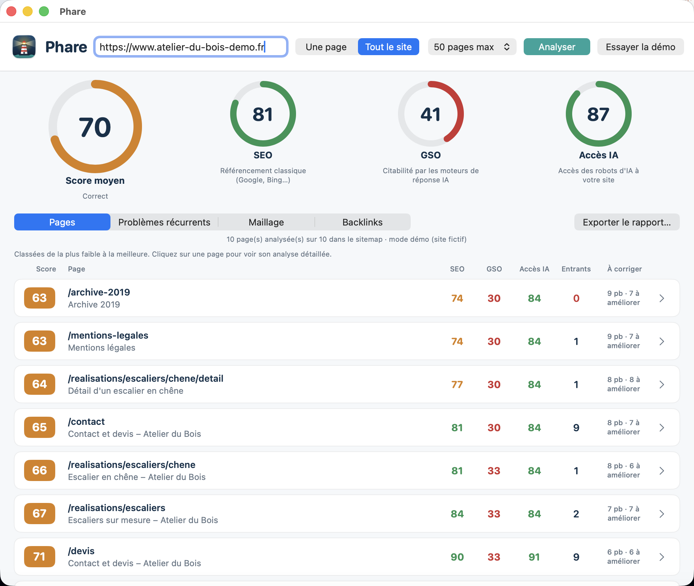
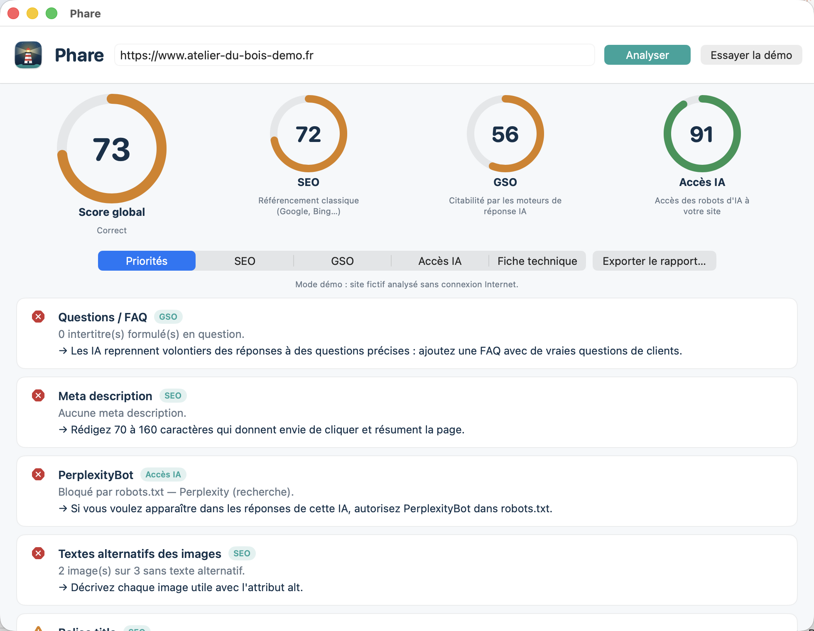
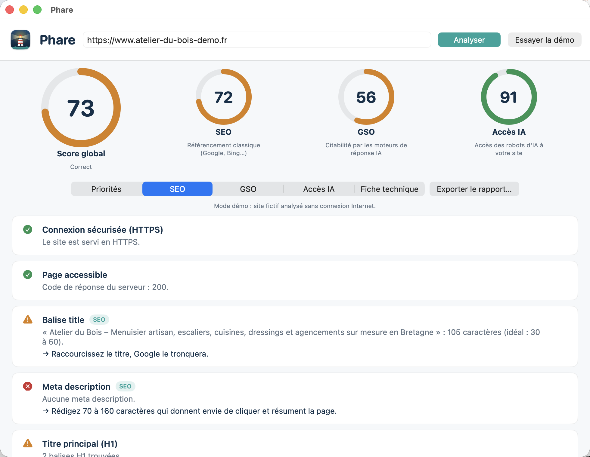
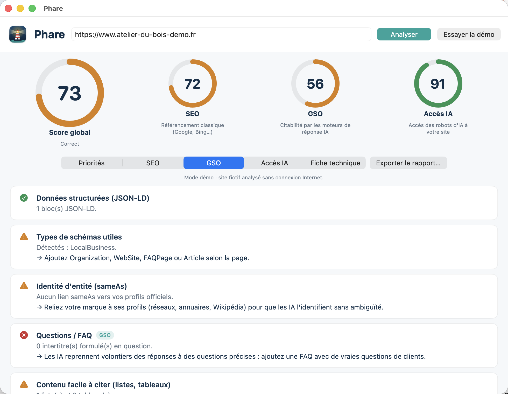
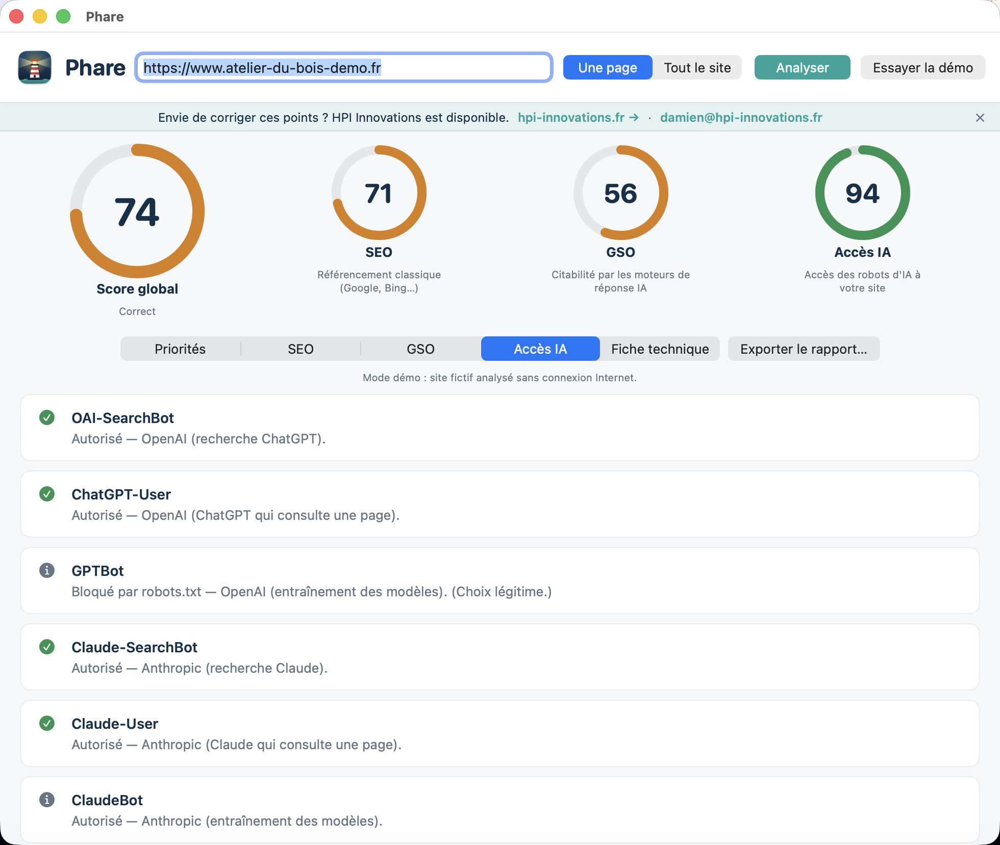
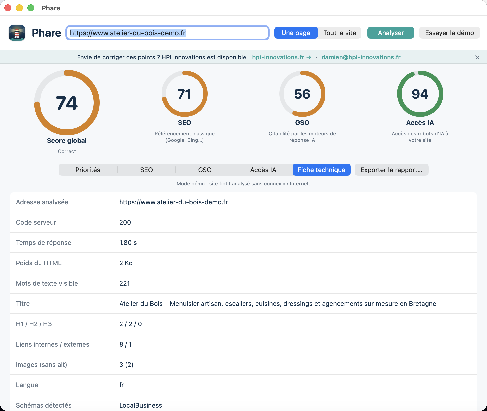
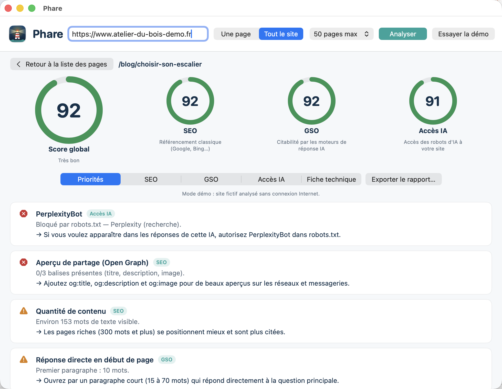
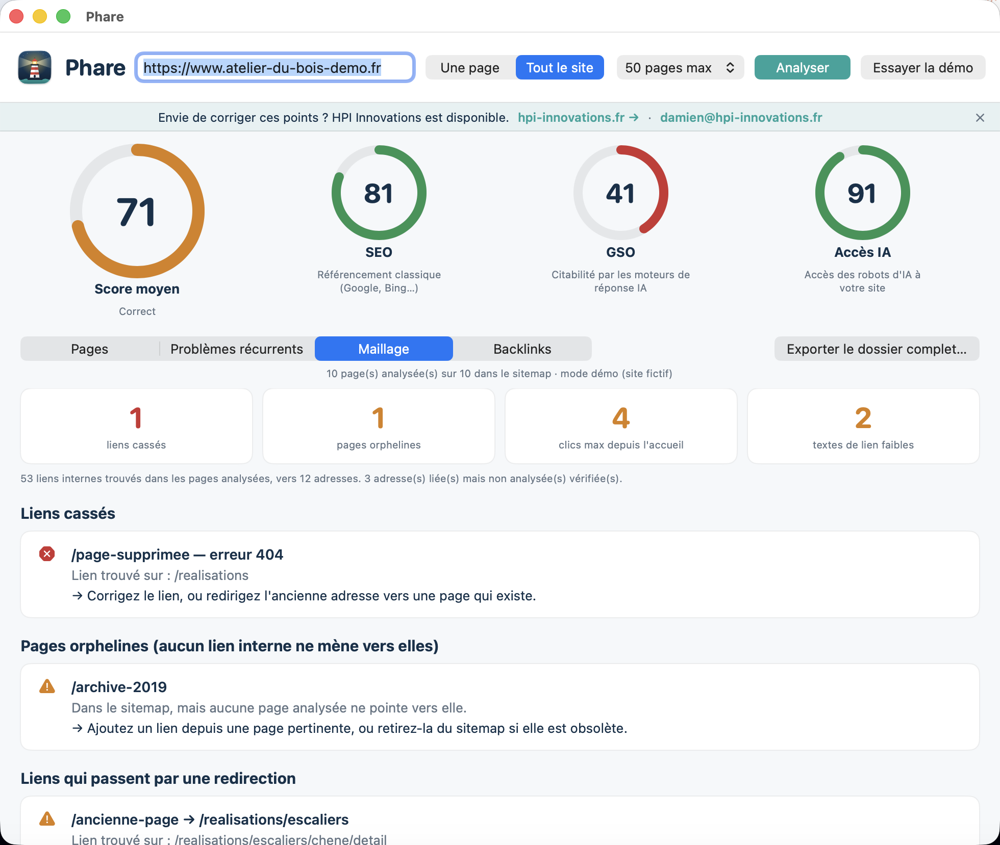
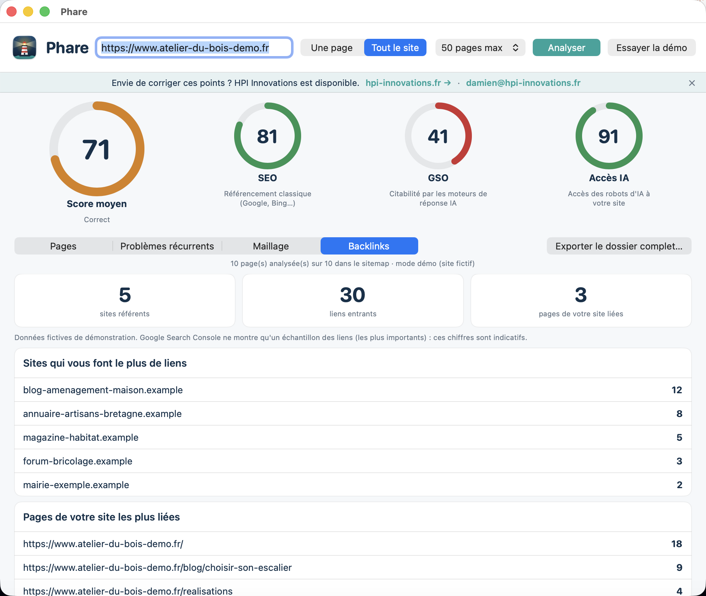

<div align="center">


# Phare

**Éclairez votre site pour Google et pour les IA.**

  

[English version](README.en.md)



</div>

Phare est une app Mac gratuite qui audite un site web sur trois axes, avec une cinquantaine de contrôles :

- **SEO** : le référencement classique (Google, Bing) : balises, titres, mobile, vitesse, sitemap, liens…
- **GSO** (*Generative Search Optimization*) : le site est-il facile à citer par ChatGPT, Claude, Perplexity, Gemini… ? Données structurées, FAQ, auteur, dates, chiffres, `llms.txt`…
- **Accès IA** : les robots d'IA peuvent-ils lire votre site d'après `robots.txt` ? Le contenu est-il lisible sans JavaScript ?

Vous obtenez trois scores sur 100, un score global et une liste de **priorités** avec le conseil pour chaque point.

L'analyse se fait **depuis votre Mac** : aucune donnée n'est envoyée à un service tiers.

> **Besoin d'aide pour corriger les points relevés ?** [HPI Innovations](https://www.hpi-innovations.fr/?utm_source=github&utm_medium=readme&utm_campaign=phare) est disponible pour vous accompagner.

## Deux modes

- **Une page** : analyse l'adresse indiquée.
- **Tout le site** : lit le `sitemap.xml`, analyse un échantillon de pages (20, 50, 100 ou 200 au maximum) et affiche un **tableau classé de la page la plus faible à la meilleure**. Un clic sur une ligne ouvre l'analyse détaillée de la page. Quatre onglets :
  - **Pages** : le tableau (score global, SEO, GSO, Accès IA, liens entrants, nombre de points à corriger) ;
  - **Problèmes récurrents** : ce qui revient sur plusieurs pages, titres en double compris ;
  - **Maillage** : audit des liens internes (voir plus bas) ;
  - **Backlinks** : import de l'export Google Search Console (voir plus bas).

## Ce que Phare vérifie

**SEO** : HTTPS, page accessible, balise `title`, meta description, titre H1, sous-titres, URL canonique, blocage d'indexation (`noindex`), affichage mobile, langue, textes alternatifs des images, aperçu de partage (Open Graph), maillage interne, textes des liens, quantité de contenu, vitesse de réponse, poids du HTML, `robots.txt`, sitemap, favicon.

**GSO** : données structurées JSON-LD et types utiles (Organization, FAQPage, Article…), identité d'entité (`sameAs`), questions / FAQ, contenu facile à citer (listes, tableaux), réponse directe en début de page, auteur (E-E-A-T), dates de publication, sources citées, chiffres et preuves, fichier `llms.txt`.

**Accès IA** : autorisation de chaque robot d'IA listé ci-dessous (d'après `robots.txt`, page par page), Googlebot et Bingbot, directive `noai`, contenu lisible sans JavaScript, site fermé à tous les robots.

### Robots d'IA vérifiés

Phare lit `robots.txt` et dit, pour chaque robot, s'il peut accéder à la page. Un robot de **recherche** ou **à la demande** bloqué est signalé comme un problème (vous perdez de la visibilité dans ses réponses). Un robot d'**entraînement** bloqué n'est qu'une information : c'est un choix légitime.

| Robot | Éditeur / usage | Type |
|---|---|---|
| `OAI-SearchBot` | OpenAI, recherche ChatGPT | Recherche |
| `ChatGPT-User` | OpenAI, ChatGPT qui consulte une page | À la demande |
| `GPTBot` | OpenAI, entraînement des modèles | Entraînement |
| `Claude-SearchBot` | Anthropic, recherche Claude | Recherche |
| `Claude-User` | Anthropic, Claude qui consulte une page | À la demande |
| `ClaudeBot` | Anthropic, entraînement des modèles | Entraînement |
| `PerplexityBot` | Perplexity, recherche | Recherche |
| `Perplexity-User` | Perplexity, consultation à la demande | À la demande |
| `Applebot` | Apple, recherche Siri et Spotlight | Recherche |
| `Amazonbot` | Amazon, réponses Alexa | Recherche |
| `DuckAssistBot` | DuckDuckGo, réponses DuckAssist | À la demande |
| `MistralAI-User` | Mistral, Le Chat qui consulte une page | À la demande |
| `Meta-ExternalFetcher` | Meta, consultation à la demande | À la demande |
| `Google-Extended` | Google, entraînement Gemini | Entraînement |
| `Applebot-Extended` | Apple, entraînement Apple Intelligence | Entraînement |
| `CCBot` | Common Crawl, base utilisée par de nombreuses IA | Entraînement |
| `Bytespider` | ByteDance, entraînement | Entraînement |
| `meta-externalagent` | Meta, entraînement | Entraînement |
| `cohere-ai` | Cohere, entraînement | Entraînement |

Phare contrôle aussi `Googlebot` et `Bingbot` (Bing alimente plusieurs moteurs IA). Les noms de robots évoluent : la liste est dans `Sources/Phare/Analyzer.swift` (`aiBots`), et ajouter un robot se fait en une ligne.

### Maillage interne (mode « Tout le site »)

Liens cassés, liens qui passent par une redirection, **pages orphelines** (aucun lien ne mène vers elles), pages à plus de 3 clics de l'accueil, textes de lien vides ou génériques (« cliquez ici »). Phare vérifie aussi jusqu'à 100 adresses liées mais non analysées. La colonne « Entrants » du tableau donne le nombre de pages qui pointent vers chaque page.

### Backlinks (mode « Tout le site »)

Phare ne peut pas savoir qui vous cite : il ne voit que votre site. Importez l'export « Liens externes » de **Google Search Console** (gratuit, pour votre propre site, fichiers `.csv` ou `.zip`) pour voir les sites qui vous citent, vos pages les plus liées et les textes d'ancrage. Des fichiers d'essai fictifs sont dans [`examples/`](examples). Chaque rapport rappelle aussi que les backlinks ne sont pas mesurés par l'analyse d'une page seule, avec une piste pour les travailler.

### Export détaillé

En mode « Tout le site », **Exporter le dossier complet…** crée un dossier contenant :

- `00-rapport-global.md` : synthèse du site (scores moyens, problèmes récurrents, maillage, backlinks, tableau des pages avec un lien vers chaque rapport) ;
- `pages/` : **un rapport détaillé par page** (analyse complète, priorités, fiche technique, place dans le site, maillage : qui pointe vers la page, vers où elle pointe, liens cassés) ;
- `pages.csv` et `problemes-par-page.csv` : tableaux pour Excel ou Numbers (une ligne par page, et une ligne par problème et par page) ;
- `LISEZ-MOI.md` : explique le contenu du dossier.

Depuis le tableau, quand vous ouvrez une page, **Exporter cette page…** n'exporte que son rapport détaillé. En mode « Une page », l'export est un seul fichier Markdown.

## Captures

<div align="center">

**Accueil** et **analyse d'une page** (priorités)

 

**SEO** et **GSO**

 

**Accès IA** (robots) et **fiche technique**

 

**Tout le site** : tableau des pages, puis détail d'une page

 

**Problèmes récurrents**, **maillage interne** et **backlinks**

  

</div>

Les captures montrent le mode démo : un site fictif (« Atelier du Bois ») analysé sans Internet.

## Installation

1. Téléchargez `Phare.dmg` dans la [dernière version](../../releases/latest).
2. Ouvrez le `.dmg` et glissez **Phare** dans **Applications**.
3. Première ouverture : l'app n'est pas notarisée par Apple (pas de compte développeur payant). Faites **clic droit → Ouvrir**, ou dans le Terminal :

```bash
xattr -dr com.apple.quarantine /Applications/Phare.app
```

Rien d'autre à installer.

## Premiers pas

1. Tapez l'adresse de votre site (ex. `www.monsite.fr`), choisissez **Une page** ou **Tout le site**, puis **Analyser**.
2. Pas de site sous la main ? **Essayer la démo** : un site fictif analysé sans Internet.
3. Lisez les **priorités**, corrigez, relancez.
4. **Exporter** pour garder une trace (Markdown, et CSV en mode « Tout le site »).

## Bandeau de contact

Une fois les résultats affichés, un bandeau discret propose les services de [HPI Innovations](https://www.hpi-innovations.fr/?utm_source=github&utm_medium=readme&utm_campaign=phare) (l'entreprise de l'auteur) pour aider à corriger les points relevés, avec un lien vers son site et une adresse e-mail. Rien n'est envoyé tant que vous ne cliquez pas : le lien ouvre votre navigateur, l'adresse ouvre un nouveau message vide dans votre application de mail. Le bandeau se ferme avec la croix.

## Compatibilité et limites connues

- Mac Apple Silicon (arm64). Le programme est compilé pour macOS 13 minimum, mais **testé uniquement sur macOS 26** (un seul Mac).
- En mode « Une page », Phare analyse **la page indiquée** et les fichiers `robots.txt`, `sitemap.xml`, `llms.txt`.
- En mode « Tout le site », les pages viennent **du sitemap uniquement** (Phare ne suit pas les liens) : sans sitemap exploitable, le mode s'arrête avec un message. Au-delà du maximum choisi, un échantillon réparti sur la liste est analysé, pas toutes les pages. Les requêtes sont limitées (4 à la fois, avec une courte pause) pour ne pas surcharger le site.
- Les contrôles de `robots.txt` et `llms.txt` sont communs à tout le site : ils apparaissent donc sur chaque page.
- Phare lit le HTML **brut**, sans exécuter JavaScript, comme le font la plupart des robots d'IA. Un site entièrement construit en JavaScript aura donc peu de contenu visible : c'est voulu, et signalé. Les liens ajoutés par JavaScript ne sont pas vus.
- Phare **n'interroge pas** ChatGPT, Claude ou Gemini pour savoir si votre site y est cité. Les scores sont des **indicateurs de bonnes pratiques**, pas une garantie de visibilité.
- `llms.txt` est un standard émergent : aucune IA ne garantit l'utiliser.
- Les règles de `robots.txt` sont interprétées de façon simple (préfixes, `*`, `$`) ; les cas très particuliers peuvent différer. Les noms et rôles des robots d'IA sont ceux connus à la rédaction : vérifiez la documentation des éditeurs.
- **Backlinks** : Phare ne les mesure pas lui-même (il faudrait un index du web entier). Il lit seulement l'export Google Search Console que vous lui donnez. Search Console ne montre qu'un échantillon des liens, et ne fonctionne que pour un site dont vous êtes propriétaire. Le lecteur de CSV est tolérant (virgule, point-virgule, tabulation, `.zip`) mais a été **testé sur des fichiers d'exemple, pas sur un vrai export Search Console** : si un fichier n'est pas reconnu, l'app l'indique.
- **Maillage** : calculé à partir des pages analysées. Si l'échantillon ne couvre pas tout le sitemap, « pages sans lien entrant » est à confirmer, et la profondeur de clics est une estimation. Seules 100 adresses non analysées sont vérifiées.
- **Ce qui a été testé** : le mode démo (une page et tout le site), un vrai site en mode « Une page » (`example.com`), le mode « Tout le site » sur un vrai site (6 pages d'un sitemap de 84), l'export en dossier. Les fichiers CSV exportés n'ont pas été ouverts dans Excel lui-même. Pas de test sur de gros sites ni sur de très gros sitemaps.

## Construire depuis les sources

Prérequis : Xcode (ou ses outils en ligne de commande) avec Swift 6.

```bash
./build_app.sh   # construit build/Phare.app (signature ad hoc)
./make_dmg.sh    # construit build/Phare.dmg + somme SHA-256
```

Mode console (tests) :

```bash
build/Phare.app/Contents/MacOS/Phare --cli --demo
build/Phare.app/Contents/MacOS/Phare --cli --site --demo
build/Phare.app/Contents/MacOS/Phare --cli --site --max=30 https://example.com
build/Phare.app/Contents/MacOS/Phare --cli --site --demo --export=/chemin/du/dossier
```

## Organisation du code

| Fichier | Rôle |
|---|---|
| `Sources/Phare/Analyzer.swift` | Vérifications SEO / GSO / Accès IA, liste des robots d'IA, récupération réseau |
| `Sources/Phare/HTMLDoc.swift` | Lecture du HTML (dont les liens), du JSON-LD et de `robots.txt` |
| `Sources/Phare/Site.swift` | Mode « Tout le site » : sitemap, analyse de plusieurs pages, audit du maillage, classement |
| `Sources/Phare/Backlinks.swift` | Lecture de l'export Google Search Console (CSV / zip) |
| `Sources/Phare/Export.swift` | Export en dossier : rapport global, un rapport par page, CSV |
| `Sources/Phare/Models.swift` | Scores, rapport, export Markdown d'une page |
| `Sources/Phare/Views.swift` | Interface SwiftUI (thème clair), bandeau de contact |
| `Sources/Phare/DemoData.swift` | Site fictif du mode démo |
| `tools/make_icon.swift` | Dessine l'icône |

## Contribuer

Les idées et corrections sont les bienvenues via les *issues* et *pull requests*. Pour ajouter une vérification, ajoutez un appel `add(...)` dans `Analyzer.swift` ; pour ajouter un robot d'IA, une ligne dans `aiBots`.

## Licence

[MIT](LICENSE) © 2026 Wudstyz. Voir aussi [THIRD_PARTY_NOTICES.md](THIRD_PARTY_NOTICES.md).
